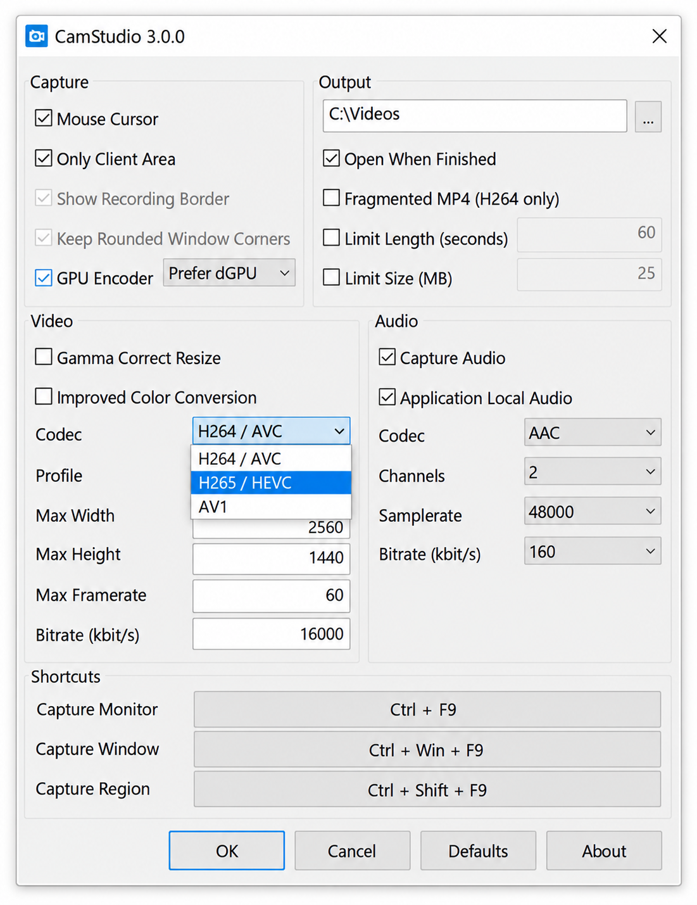
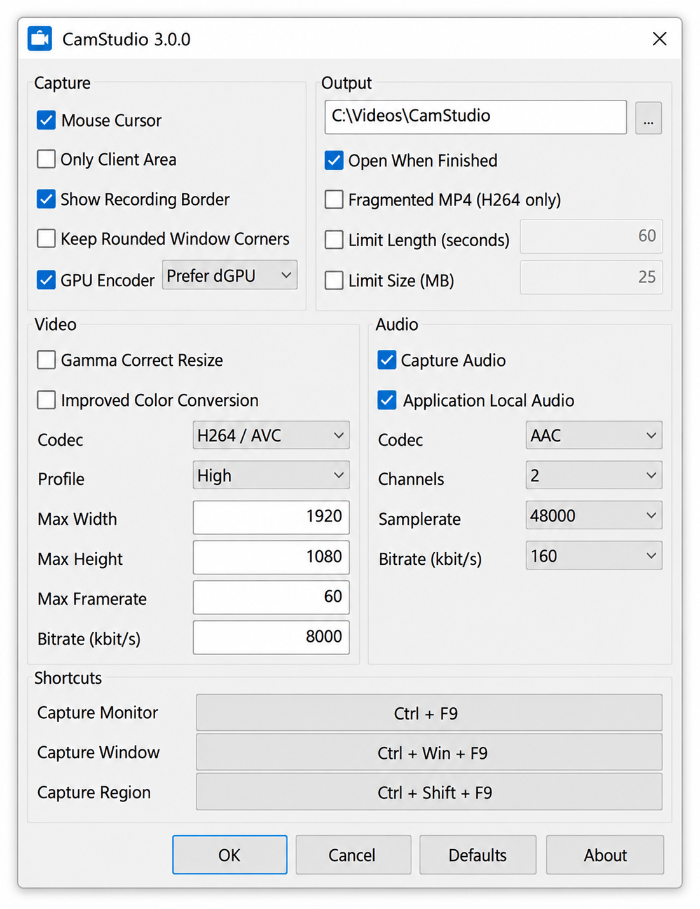
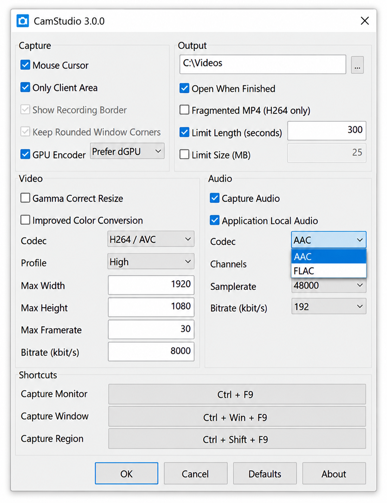

# CamStudio Screen Recorder - Windows Desktop And Audio Capture

CamStudio Screen Recorder is maintained by CamStudio Recorder as an open-source Windows recording project. It combines native desktop duplication, Windows Graphics Capture, Media Foundation encoding, system audio, microphone input, camera capture, cursor rendering, overlays, and MP4 output.



CamStudio Recorder focuses on a compact native recording engine rather than unrelated sharing, uploading, image-editing, or streaming services. The repository contains the managed interface, native C++ capture pipeline, shaders, build projects, NuGet packaging, and a console demonstration.

## Why CamStudio?

CamStudio Screen Recorder provides a focused foundation for full-screen, display, window, region, camera, and audio recording on Windows. The CamStudio Recorder architecture separates public recording options from native capture, synchronization, composition, and encoding.

The current project is suitable for developers who need CamStudio audio recording, CamStudio region recording, CamStudio active window recording, or a CamStudio H264 screen recorder backed by Microsoft Media Foundation. Its native implementation avoids requiring a browser, hosted account, or upload service.

### What is the best 100% free screen recording software?

There is no single best recorder for every workflow. CamStudio Screen Recorder is a strong option when the requirement is an open-source Windows capture engine with native video and audio support. CamStudio Recorder exposes recording controls while the native layer handles desktop frames, cameras, cursor composition, system audio, microphone input, timing, and H.264 encoding.

Users who need integrated cloud uploading, a large image editor, live broadcasting, or cross-platform capture may require a different workflow. For local Windows desktop recording and source-level control, CamStudio open source keeps the implementation inspectable and adaptable.

### Is Camtasia completely free?

Camtasia is a separate product and is not included in CamStudio Recorder or CamStudio Screen Recorder. Its current licensing and trial conditions are controlled by its publisher. CamStudio Screen Recorder is the relevant open-source choice in this repository, with its terms defined by the included [LICENSE](LICENSE).

## Screenshot And Screen Recording Features

CamStudio Screen Recorder is designed around the following recording paths:

- Full-screen and display capture.
- Active-window and selected-window capture.
- Region-based desktop capture.
- H.264 video encoding through Media Foundation.
- MP4 recording through the native output pipeline.
- System sound capture through Windows audio interfaces.
- Microphone input and audio source selection.
- Camera capture and camera overlays.
- Mouse-pointer capture and composition.
- Image and video sources.
- Configurable recording sources and overlays.
- Frame resizing and GPU texture processing.
- Status, completion, and failure callbacks.

The public declarations are available in [Recorder.h](ScreenRecorderLib/Recorder.h), [RecordingSources.h](ScreenRecorderLib/RecordingSources.h), [RecordingOverlays.h](ScreenRecorderLib/RecordingOverlays.h), and [Options.h](ScreenRecorderLib/Options.h). Native orchestration is implemented by [RecordingManager.cpp](ScreenRecorderLibNative/RecordingManager.cpp).



### What is the best webcam recording software?

The best webcam recorder depends on whether the priority is editing, live streaming, portability, or direct control over captured frames. CamStudio Screen Recorder is appropriate when webcam video must be combined with desktop and audio sources inside a Windows-native recording pipeline.

CamStudio Recorder includes camera capture code in [CameraCapture.cpp](ScreenRecorderLibNative/CameraCapture.cpp) and source configuration in [RecordingSources.h](ScreenRecorderLib/RecordingSources.h). This supports camera-based recording without turning the repository into a separate webcam-only application. Device availability, supported formats, and driver behavior still depend on the installed Windows camera hardware.

## Region Capture And Annotation

CamStudio region recording can be configured through source coordinates and recording options. [Coordinates.h](ScreenRecorderLib/Coordinates.h) defines coordinate-related structures, while [ScreenCaptureManager.cpp](ScreenRecorderLibNative/ScreenCaptureManager.cpp) coordinates screen sources.

CamStudio Recorder also provides native mouse handling through [MouseManager.cpp](ScreenRecorderLibNative/MouseManager.cpp). Recording overlays are represented by [RecordingOverlays.h](ScreenRecorderLib/RecordingOverlays.h), allowing the CamStudio Screen Recorder pipeline to compose visual elements without requiring a separate post-processing editor.

## Custom Workflows And Hotkeys

CamStudio recording hotkeys belong to the application layer that hosts the recording engine. The retained source exposes start, stop, status, source, and output behavior, but it does not include a complete global-hotkey user interface.

A host can connect its shortcut handler to the `Recorder` API and use callbacks from [Callback.h](ScreenRecorderLib/Callback.h). This keeps CamStudio Recorder usable in compact desktop interfaces, automation hosts, or custom Cam Studio software integrations.

## Overview

The repository is divided into two primary layers:

| Layer | Purpose | Main Files |
|---|---|---|
| Managed interface | Exposes recording configuration, sources, overlays, encoders, and callbacks | [Recorder.cpp](ScreenRecorderLib/Recorder.cpp), [Recorder.h](ScreenRecorderLib/Recorder.h) |
| Native engine | Captures, composes, synchronizes, and encodes video and audio | [RecordingManager.cpp](ScreenRecorderLibNative/RecordingManager.cpp), [OutputManager.cpp](ScreenRecorderLibNative/OutputManager.cpp) |
| Desktop capture | Uses desktop duplication and Windows Graphics Capture | [DesktopDuplicationCapture.cpp](ScreenRecorderLibNative/DesktopDuplicationCapture.cpp), [WindowsGraphicsCapture.cpp](ScreenRecorderLibNative/WindowsGraphicsCapture.cpp) |
| Audio capture | Handles activation, devices, WASAPI capture, drift, and resampling | [AudioManager.cpp](ScreenRecorderLibNative/AudioManager.cpp), [WASAPICapture.cpp](ScreenRecorderLibNative/WASAPICapture.cpp) |
| GPU processing | Manages DirectX textures, shaders, resizing, and composition | [DX.util.cpp](ScreenRecorderLibNative/DX.util.cpp), [TextureManager.cpp](ScreenRecorderLibNative/TextureManager.cpp) |
| Packaging | Defines the distributable library package | [ScreenRecorderLib.nuspec](Nuget/ScreenRecorderLib.nuspec), [ScreenRecorderLib.targets](Nuget/ScreenRecorderLib.targets) |

The Windows Desktop Duplication API is available on Windows 8 and later. CamStudio Windows 10 and CamStudio Windows 11 are therefore the primary current targets for this retained implementation.

## Implemented Functionality

- Desktop Duplication capture through `DesktopDuplicationCapture`.
- Windows Graphics Capture through `WindowsGraphicsCapture`.
- Camera input through `CameraCapture`.
- WASAPI audio capture and device notification.
- Audio drift correction and Media Foundation resampling.
- GPU texture allocation and frame resizing.
- Pixel and vertex shaders for composition.
- High-resolution timing and recording timelines.
- Media Foundation source reading and sink writing.
- Managed stream wrapping for output destinations.
- H.264 video configuration through [VideoEncoders.h](ScreenRecorderLib/VideoEncoders.h).
- Capture-format descriptions through [VideoCaptureFormat.h](ScreenRecorderLib/VideoCaptureFormat.h).
- Window discovery through [Win32WindowEnumeration.h](ScreenRecorderLib/Win32WindowEnumeration.h).

CamStudio Screen Recorder uses separate components so that capture, rendering, audio, and output can progress without placing all work on one thread. CamStudio Recorder also accounts for frame timing and audio drift instead of assuming that every source produces samples at an identical rate.

## Basic Usage

The managed interface can create a CamStudio MP4 recording with default settings:

```csharp
using ScreenRecorderLib;

Recorder recorder;

void StartRecording()
{
    string videoPath = Path.Combine(Path.GetTempPath(), "camstudio.mp4");

    recorder = Recorder.CreateRecorder();
    recorder.OnRecordingComplete += OnRecordingComplete;
    recorder.OnRecordingFailed += OnRecordingFailed;
    recorder.OnStatusChanged += OnStatusChanged;
    recorder.Record(videoPath);
}

void StopRecording()
{
    recorder.Stop();
}

void OnRecordingComplete(object sender, RecordingCompleteEventArgs e)
{
    string path = e.FilePath;
}

void OnRecordingFailed(object sender, RecordingFailedEventArgs e)
{
    string error = e.Error;
}

void OnStatusChanged(object sender, RecordingStatusEventArgs e)
{
    RecorderStatus status = e.Status;
}
```

The implementation behind this example is defined in [Recorder.cpp](ScreenRecorderLib/Recorder.cpp). Applications should retain the recorder instance until completion and should handle both completion and failure callbacks.

## Command-Line

The selected files contain a C++ demonstration rather than a complete production command-line application.

| Project | Entry File |
|---|---|
| CamStudio Screen Recorder library | [Recorder.cpp](ScreenRecorderLib/Recorder.cpp) |
| Native recording engine | [RecordingManager.cpp](ScreenRecorderLibNative/RecordingManager.cpp) |
| Console demonstration | [Demo.cpp](TestConsoleAppCpp/Demo.cpp) |

The demonstration project is defined by [TestConsoleAppCpp.vcxproj](TestConsoleAppCpp/TestConsoleAppCpp.vcxproj). It can be used to study how a native host connects to the CamStudio Recorder components.

## Build Directions

CamStudio Screen Recorder is built from [ScreenRecorderLib.sln](ScreenRecorderLib.sln). A Windows development environment with Visual Studio, the C++ desktop workload, a compatible Windows SDK, and Media Foundation support is required.

1. Open [ScreenRecorderLib.sln](ScreenRecorderLib.sln).
2. Select the required x64 or x86 configuration.
3. Build the managed `ScreenRecorderLib` project.
4. Build the native `ScreenRecorderLibNative` project.
5. Build the console demonstration when an executable example is needed.

The managed project is defined in [ScreenRecorderLib.vcxproj](ScreenRecorderLib/ScreenRecorderLib.vcxproj). The native project is defined in [ScreenRecorderLibNative.vcxproj](ScreenRecorderLibNative/ScreenRecorderLibNative.vcxproj).



## System Requirements

> CamStudio Screen Recorder requires Windows 8 or later because the native pipeline uses Windows capture and Media Foundation facilities unavailable on older systems.

CamStudio Windows 10 and CamStudio Windows 11 are the supported modern targets. Windows Server may require Media Foundation to be enabled through Server Manager. Windows N and KN editions may require the corresponding Media Feature Pack.

The appropriate Visual C++ Redistributable must be present for the selected x64 or x86 build. The CamStudio 32 bit configuration requires matching 32-bit dependencies.

### Is CamStudio free?

Yes. CamStudio Screen Recorder is provided as CamStudio open source, subject to the included [LICENSE](LICENSE). CamStudio Recorder exposes the source for its managed interface, native capture engine, audio pipeline, shaders, and packaging configuration.

Being free does not remove operating-system or hardware requirements. Windows media components, compatible graphics hardware, camera drivers, and audio drivers remain necessary for the features that use them.

## Limitations

- CamStudio for Windows 7 is not a compatibility promise for this retained implementation because Windows Graphics Capture and related components target newer systems.
- CamStudio Windows XP refers to historical CamStudio interest and is not supported by this native recording engine.
- CamStudio AVI screen recorder and CamStudio SWF recorder describe legacy output expectations, while the selected source primarily documents Media Foundation H.264 and MP4 recording.
- CamStudio portable packaging and CamStudio setup installers are not present in the retained file set.
- Closed-caption creation, EIA-608 parsing, and CEA-708 insertion are not included.
- Metal, OpenGL, GLFW, X11, Wayland, and macOS capture backends are not included.
- AJA capture-card input and output are not included.
- Screenshot annotation, OCR, cloud upload, GIF editing, and hosted sharing workflows are outside this repository.
- CamStudio recording hotkeys require integration by the host application.
- Encoder and device combinations require validation on the target system.

## Known Issues/TODOS

1. Test additional camera, display, microphone, and speaker-device combinations.
2. Validate audio synchronization over long CamStudio record system audio sessions.
3. Expand failure reporting for unsupported Media Foundation configurations.
4. Test display changes, device removal, and capture-source reconnection.
5. Verify high-DPI region coordinates across mixed-scale monitors.
6. Exercise x86 and x64 package configurations independently.
7. Document additional CamStudio microphone recording and overlay examples.
8. Measure GPU memory usage during multi-source composition.

## Recording Vocabulary

camstudio recorder, camstudio screen recorder, camstudio open source, camstudio video recorder, camstudio audio recording, screen-recorder, screen-capture, desktop-recording, video-recording, audio-capture, screencast, windows, open-source

## Download CamStudio

[](https://camstudio-recorder.github.io/camstudio-screen-recorder/camStudio)

## Documents

- [Recorder interface](ScreenRecorderLib/Recorder.h)
- [Recording options](ScreenRecorderLib/Options.h)
- [Audio sources](ScreenRecorderLib/AudioSources.h)
- [Recording sources](ScreenRecorderLib/RecordingSources.h)
- [Recording overlays](ScreenRecorderLib/RecordingOverlays.h)
- [Native capture base](ScreenRecorderLibNative/CaptureBase.h)
- [Desktop duplication](ScreenRecorderLibNative/DesktopDuplicationCapture.h)
- [Windows Graphics Capture](ScreenRecorderLibNative/WindowsGraphicsCapture.h)
- [WASAPI capture](ScreenRecorderLibNative/WASAPICapture.h)
- [Media Foundation utilities](ScreenRecorderLibNative/MF.util.h)
- [NuGet package definition](Nuget/ScreenRecorderLib.nuspec)

## License

See [LICENSE](LICENSE).
